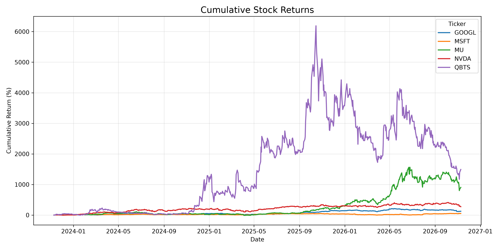
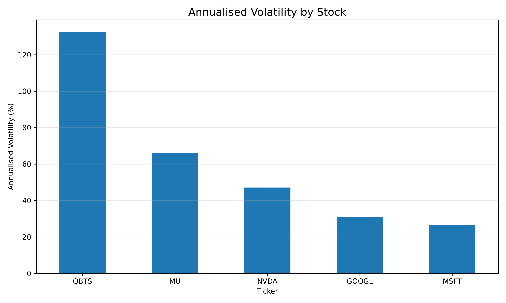
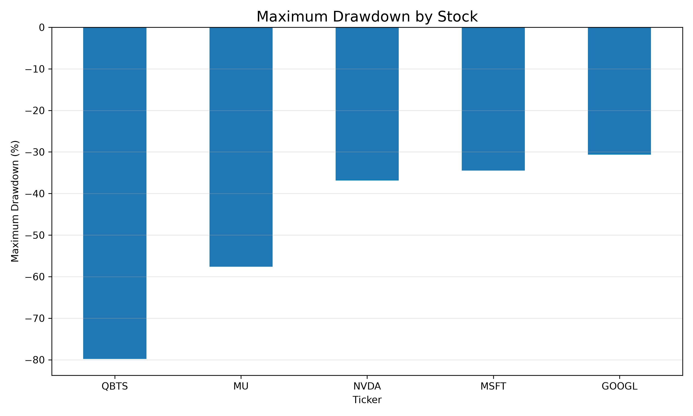

# Financial Market Data Pipeline & Risk Analytics

An end-to-end personal project that collects historical stock market data, validates and stores it, performs SQL-based analysis, and calculates historical return and risk metrics using Python.

## Overview

This project demonstrates a reproducible analytical workflow for daily market data:

1. Fetch historical prices and trading volumes.
2. Clean and validate the collected data.
3. Run automated data-quality tests.
4. Load the cleaned dataset into a SQLite database.
5. Analyse the data with SQL, including window functions and CTEs.
6. Calculate historical returns, annualised volatility, and maximum drawdown.
7. Export summary tables and visual reports.

**Technologies:** Python, Pandas, NumPy, yfinance, SQLite, SQL, Matplotlib, pytest.

**Assets analysed:** GOOGL, MSFT, MU, NVDA, QBTS  
**Data frequency:** Daily  
**Dataset size:** 3,760 records (751 observations per ticker in the reported run)  
**Period:** Approximately three years; exact dates depend on the data retrieval run.

> This is a personal educational project, not an investment recommendation or a production financial data platform.

## Repository structure

```text
Financial-Market-Data-Pipeline-Analytics/
├── data/
│   ├── market_data.csv
│   ├── cleaned_market_data.csv
│   └── market_data.db
├── src/
│   ├── fetch_data.py
│   ├── validate_data.py
│   ├── load_database.py
│   ├── run_queries.py
│   ├── run_advanced_queries.py
│   ├── calculate_risk.py
│   └── visualize_results.py
├── sql/
│   ├── analytics.sql
│   ├── advanced_analytics.sql
│   └── risk_analytics.sql
├── tests/
│   └── test_data_quality.py
├── reports/
│   ├── data_quality_report.txt
│   ├── risk_analytics_summary.csv
│   ├── cumulative_returns.png
│   ├── annualised_volatility.png
│   └── maximum_drawdown.png
├── requirements.txt
└── README.md
```

## Setup

The instructions below use Windows PowerShell.

### 1. Clone the repository

```powershell
git clone <YOUR_REPOSITORY_URL>
cd Financial-Market-Data-Pipeline-Analytics
```

### 2. Create and activate a virtual environment

```powershell
python -m venv .venv
.\.venv\Scripts\Activate.ps1
```

If PowerShell blocks activation, you can use the environment's Python executable directly:

```powershell
.\.venv\Scripts\python.exe -m pip install -r requirements.txt
```

### 3. Install dependencies

```powershell
python -m pip install -r requirements.txt
```

## Running the pipeline

Run the scripts from the project root directory, in the following order.

### 1. Fetch historical data

```powershell
python src/fetch_data.py
```

This retrieves daily market data and saves the raw dataset under `data/`.

### 2. Validate and clean the data

```powershell
python src/validate_data.py
```

The validation process checks for missing values, duplicate records, invalid prices, negative volume, inconsistent OHLC values, and potential date gaps. It writes the cleaned dataset and a text quality report.

The date-gap check is a preliminary calendar-based check, not an exchange-calendar-aware trading-session validation.

### 3. Run automated tests

```powershell
pytest -v
```

The current test suite includes checks for invalid prices and duplicate records.

### 4. Load data into SQLite

```powershell
python src/load_database.py
```

This creates or replaces the `market_prices` table and adds an index on `(ticker, date)`.

### 5. Run SQL analytics

```powershell
python src/run_queries.py
python src/run_advanced_queries.py
```

The SQL analyses include record counts, average prices and volumes, daily returns, moving averages, and per-ticker return statistics.

### 6. Calculate risk metrics

```powershell
python src/calculate_risk.py
```

The script calculates and exports the risk summary to `reports/risk_analytics_summary.csv`.

### 7. Generate visualisations

```powershell
python src/visualize_results.py
```

The script generates the charts in the `reports/` directory.

## Methodology

### Daily return

For each ticker, daily simple return is calculated from consecutive adjusted closing prices:

\[
r_t = \frac{P_t}{P_{t-1}} - 1
\]

### Cumulative return

Daily returns are compounded over the available observation period:

\[
R_{\mathrm{total}} =
\left(\prod_{t=1}^{n}(1+r_t)-1\right)\times100
\]

### Annualised volatility

Daily return standard deviation is annualised using an assumed 252 trading days per year:

\[
\sigma_{\mathrm{annual}} =
\sigma_{\mathrm{daily}}\sqrt{252}\times100
\]

### Maximum drawdown

For each ticker, the cumulative value series is compared with its running historical peak. Maximum drawdown is the largest peak-to-trough percentage decline.

## Results

The following figures are from one completed run of the project. Results can change when the data is refreshed.

| Ticker | Annualised volatility | Cumulative return | Maximum drawdown |
|---|---:|---:|---:|
| GOOGL | 31.13% | 125.37% | -30.62% |
| MSFT | 26.57% | 53.37% | -34.50% |
| MU | 66.19% | 905.11% | -57.63% |
| NVDA | 47.16% | 274.21% | -36.88% |
| QBTS | 132.50% | 1,491.29% | -79.79% |

### Visualisations

The visualisation script creates:

- `reports/cumulative_returns.png` — cumulative return comparison over time.
- `reports/annualised_volatility.png` — annualised volatility by ticker.
- `reports/maximum_drawdown.png` — maximum drawdown by ticker.

You can embed the charts in this README after committing the report images:

```markdown



```

### Observations

- MSFT had the lowest annualised volatility among the five selected stocks in this sample.
- QBTS had the highest annualised volatility and the largest maximum drawdown.
- MU and QBTS recorded the highest cumulative returns in this historical sample, alongside substantial volatility and drawdowns.
- Looking at cumulative return, volatility, and drawdown together provides a more balanced description of historical performance than considering returns alone.

These are descriptive historical results, not forecasts or investment recommendations.

## Data quality and limitations

- Market data is retrieved through `yfinance`, an unofficial interface to Yahoo Finance. Availability, adjustments, and historical accuracy depend on the upstream provider.
- The reported run contained 3,760 records across five tickers, with no missing values, duplicates, non-positive prices, negative volumes, or inconsistent OHLC ranges detected by the implemented checks.
- The calendar-gap check is only a preliminary check. Weekends and exchange holidays mean that a production-quality solution should use an exchange trading calendar.
- The current automated tests cover invalid prices and duplicate records. More tests could be added for missing values, invalid dates, volume anomalies, and OHLC consistency.
- SQLite is appropriate for this small project. A larger or multi-user workflow could use a server-based database.
- The scripts are currently run manually. Scheduling, structured logging, retry handling, and monitoring would be useful future enhancements.
- Annualised volatility uses the conventional 252-trading-day assumption. It is a historical estimate, not a prediction of future volatility.
- The cumulative return and drawdown results depend on the selected date range and the adjusted-price series returned by the data provider.

## Possible future improvements

- Use an exchange-aware trading calendar for completeness checks.
- Expand the automated test suite and add validation for schema and data types.
- Add structured logging, exception handling, and retry logic to the ingestion process.
- Schedule ingestion and reporting.
- Add rolling volatility, benchmark-relative performance, and portfolio-level metrics.
- Evaluate PostgreSQL for larger datasets and concurrent access.

## Disclaimer

This repository is for educational and portfolio-demonstration purposes only. It does not provide financial advice, trading signals, or investment recommendations. Historical performance does not guarantee future results.

## Data source

Historical market data is retrieved using [`yfinance`](https://github.com/ranaroussi/yfinance). Please review the data provider's terms and the library documentation before using the data for purposes beyond personal research.
